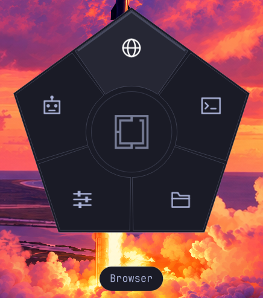

<h1 align="center">Orb</h1>

<p align="center">A shortcut wheel for Omarchy.</p>

<p align="center"><a href="https://github.com/tcballard/omarchy-badges"></a></p>

Launch apps, switch themes and open your installed coding agents from a wheel near your pointer. Press **Super+Alt+O**, then click an icon or select it with the keyboard and press Enter. Choose six to eight shortcuts in Orb’s settings; the wheel follows your Omarchy shell theme.

**For current Omarchy Quattro.** [Install and update](#install).



Real XPS capture with eight shortcuts; six by default. [Capture details](docs/PREVIEW.json).

Inspired by **Tangerine for Mac**. Original implementation built from Tom Ballard’s [Omarchy plugin starter](https://github.com/tcballard/build-omarchy-plugins). [Credits](CREDITS.md).

## Install

```bash
omarchy plugin add https://github.com/tcballard/omarchy-plugin-orb.git --enable
```

Installs from `main`. Orb creates its settings on first enable and registers **Super+Alt+O** while enabled. No separate installer or source checkout is needed. Existing settings are retained. A conflicting shortcut opens an in-app error with a retry button and leaves the existing binding alone.

Update:

```bash
omarchy plugin update io.github.tcballard.orb
```

Remove:

```bash
omarchy plugin remove io.github.tcballard.orb
```

For an existing v0.1.0 install that tracks a local source checkout, remove and add Orb once through the normal plugin manager to switch it to this public repository; saved settings are retained.

Disabling or removing Orb releases its runtime bindings; your Orb settings remain. The old installer’s unmodified binding module is migrated automatically, with backups. User-modified legacy modules are preserved and reported for review.

Requires current Quattro with `PointerMoveGate`, the normal Omarchy launchers, Bash, Git, jq and libnotify. Node and a compiler are only development dependencies.

## Use and configure

- Optional **right-click on empty desktop** also opens Orb. This is enabled on this XPS; applications retain their context menus. Super+Alt+O remains available.
- Hover a sector and left-click to launch. The centre logo glows on hover; click it to open Orb’s compact settings panel. In a submenu, the centre goes back.
- Arrow keys or Tab/Shift+Tab cycle; 1–8 select an available slot; Enter launches. Home selects the centre button; Enter opens Orb settings (or goes back in a submenu). In settings, use **Slots** to choose each position’s shortcut or installed app. Six slots are the default; **Add slot** expands the wheel to seven or eight. Remove a slot with **×** (or Delete on the selected row) to return to six; search for **Postcard** to use its editor. **Appearance** controls wheel size and opening animation. Press Save to apply; Cancel/Escape discards changes. Tab moves between controls, arrows adjust size or browse search results, Enter chooses, and Ctrl+S saves. Escape in search returns to the slot list.
- Escape/Left/Backspace or the centre button returns from a submenu. Escape on the wheel, outside click, or the summon shortcut again dismisses.
- Sectors show centred icons at every wheel size. The full hovered or keyboard-selected action name appears beneath Orb, including in submenus. Its text and pill grow with the wheel, retaining a readable minimum at small sizes.
- The wheel and keyboard hint stay clear of monitor edges and reserved bar space.
- Submenus with more than six actions use footer arrows, scrolling or Page Up/Down.
- **Make something cool** is an optional slot: search for it in Slots to add a circular **New theme / New plugin / New app** menu. Selecting a starter opens your default Omarchy agent with the same prompt used by the native Agents panel.
- Opening animates for 190ms; system reduced motion is respected.

For advanced custom commands, edit `~/.config/omarchy/orb.json` for six to eight top-level labels, icons, command argument arrays, one-level `children` menus, an installed-agent menu (`"menu": "agents"`), diameter, animation and shortcut. The default diameter is 240 theme units, currently 280px on the XPS. See [the example](config.example.json). The picker offers the standard shortcuts, Settings and Agents circular menus, Themes, Plugins, Postcard (requires the Postcard plugin), and installed applications from Quattro’s app library. App choices store a `desktopId` and launch through that same library; icons follow the installed application. Commands run without shell-string evaluation. Set `"desktopRightClick": true` to enable desktop-only right-click . It uses Hyprland’s auto-consuming binding: app, panel and widget clicks pass through. Desktop right-click now opens Orb in place of the wallpaper’s right-double-click theme gesture; Themes remains available as a slot choice. Conservative panel bounds, including the dock’s transparent area, are excluded. Other changes load live; shortcut and desktop activation changes also apply live. Invalid configuration retains the last valid actions and shows an error hint.

```bash
omarchy-shell shell toggle io.github.tcballard.orb
omarchy-shell shell hide io.github.tcballard.orb
omarchy-shell io.github.tcballard.orb status
```

## Verification and limits

Developed on a Dell XPS 9320, 1920×1200 at scale 1, Omarchy dev `5f7aaeb8c`. [Acceptance evidence](docs/ACCEPTANCE.json) separates portable checks from direct desktop tests. [Development](docs/DEVELOPMENT.md) · [Architecture](ARCHITECTURE.md) · [Demo and recording](docs/DEMO.md).

Six to eight configurable top-level entries with one submenu level. The panel does not yet edit custom command arguments, submenu contents or the summon shortcut. Agent discovery filters out first-run installer wrappers, requires a real installed executable, and does not alter the default agent. Multiple physical monitors, hotplug and fractional scaling need further live testing. Screenshot verification covers opening and cancelling the capture UI, not saving a capture. Theme verification uses real shell palette-change IPC and restores it; full desktop/app retinting is not exercised. The owner confirmed final native validation, physical shortcut/focus behaviour, the six-to-eight-to-six saved-slot flow, light/dark captions and reinstall on 2026-10-19; automated evidence remains separately identified.

Codex, Claude and Grok use the product marks bundled with Omarchy’s agents panel, with contrasting variants for light and dark themes. [Asset provenance](CREDITS.md#agent-marks).

Version 0.1.1 fixes native installation. Portable lifecycle fixtures, QML parsing and the upstream manifest validator pass. Tom has tested v0.1.1 on his XPS and confirmed that it works. This is owner-reported acceptance; new instrumented lifecycle logs were not collected. Version 0.1.0’s owner acceptance applies to the previous installer flow. Marketplace snapshot updates require maintainer approval.

Orb itself makes no network requests and requires no authentication. Applications and agents you launch can use their own network connections and accounts. Agent discovery reads installed executables and, when present, the local mise inventory; it does not install agents. Runtime helpers require the normal Omarchy launchers, Bash, jq and standard system utilities. The plugin reads the pointer position with `hyprctl` and starts the selected application or agent after dismissing the wheel.

Installation writes the plugin checkout through Omarchy and creates `~/.config/omarchy/orb.json` only if missing, plus an Orb setup lock. Fresh installations do not write Hyprland configuration files. Migration of the old installer removes only its unchanged module and exact owned include, with backups. The plugin manager records enablement in shell configuration. Removal retains Orb settings and migration backups. Runtime bindings are recreated after Hyprland reload; restarting the shell recovers them after a shell crash. Custom command arguments in `orb.json` are trusted local configuration.

Report problems through [GitHub issues](https://github.com/tcballard/omarchy-plugin-orb/issues), including your Omarchy version and reproduction steps. See [security reporting](SECURITY.md) for sensitive reports and [release evidence](docs/RELEASE.md) for release gates.

## Licence

[MIT](LICENSE). Third-party software and media retain their own licences.
